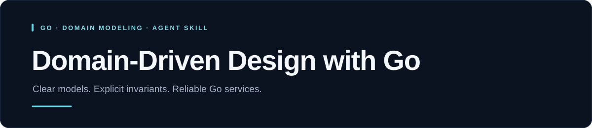

[](https://github.com/elkaix/go-ddd/actions/workflows/ci.yml)

An agent skill for designing, implementing, refactoring, reviewing, and explaining domain-driven Go services.

Build from business language and invariants through aggregate boundaries, idiomatic Go, persistence, and reliable integrations. The workflow favors focused changes and architecture justified by the actual problem.

## Install

Install with the [Skills CLI](https://skills.sh/docs/cli) and follow its agent-selection prompts:

```sh
npx skills add elkaix/go-ddd
```

Select `go-ddd` in your agent’s skill interface. For manual use, give the agent the path to `SKILL.md` and keep the complete folder together.

## Use

```text
Use go-ddd to review this Go service’s checkout flow.
Inspect the existing code, map its invariants and transaction boundaries,
and check concurrency, payment retries, and recovery behavior.
Report confirmed defects with evidence and the smallest correction.
```

## Explore

| Resource | Contents |
| --- | --- |
| [Skill](SKILL.md) | Main workflow and completion criteria |
| [Modern Go](references/modern-go.md) | Go 1.27.4 baseline, release checks, and current engineering practices |
| [Guides](references/) | Modeling, Go implementation, consistency, evolution, testing, commerce, and source mapping |
| [Go example](assets/order-example/) | Original order aggregate, money values, and behavioral tests |
| [Source map](references/source-map.md) | Upstream observations, corrections, and primary references |

The example illustrates domain behavior; adapt its limits and rules to your application. Formatting, vet, race-enabled tests, and vulnerability checks run in [CI](https://github.com/elkaix/go-ddd/actions/workflows/ci.yml).

## Attribution

Inspired by Packt Publishing’s *Domain-Driven Design with Golang* by Matt Boyle, reviewed at [revision `c1da720`](https://github.com/PacktPublishing/Domain-Driven-Design-with-GoLang/tree/c1da720aee79d136924857191a9c5d2ab0a53517). The skill instructions and bundled Go example are original.
